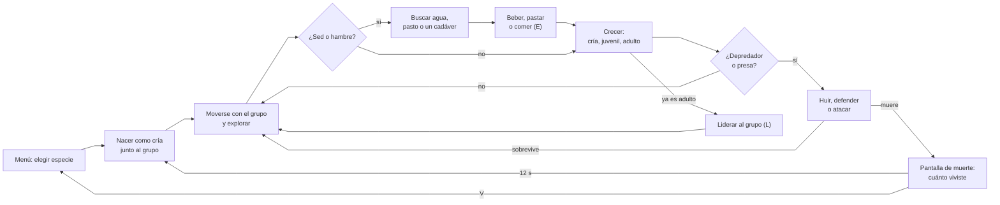
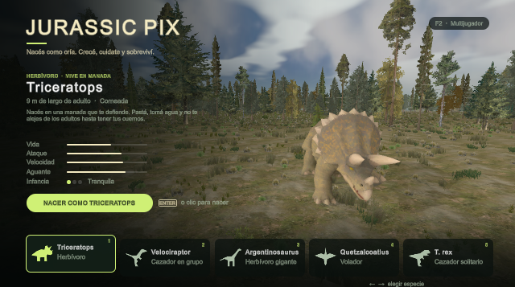
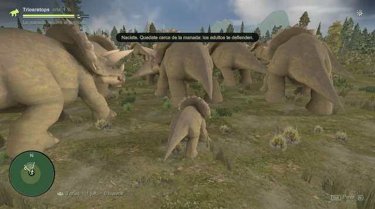
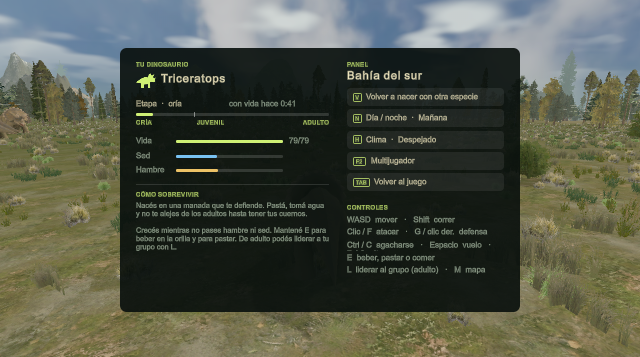
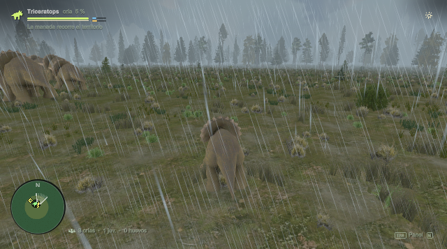
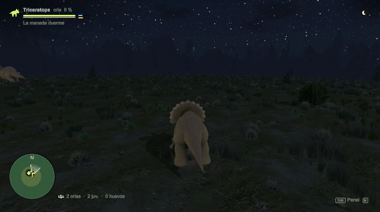
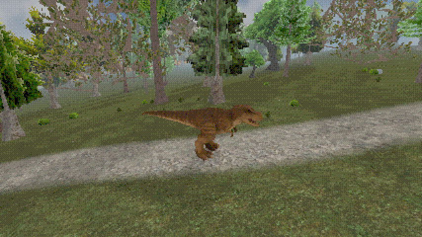

# Jurassic Pix — Avance del diseño del juego

| | |
| --- | --- |
| **Institución** | Universidad Nacional de Jujuy — Facultad de Ingeniería |
| **Carrera** | Tecnicatura Universitaria en Diseño Integral de Videojuegos |
| **Asignatura** | Programación de Videojuegos II — Período lectivo 2026 |
| **Docente** | Samuel Bustamante |
| **Integrantes** | Awki Gimenez — Calatayud Alex |
| **Fecha de corte** | 22/11/2026 |
| **Documentos relacionados** | [Diagramas UML y aplicación de SOLID](Diagrama_UML.md) · [README del juego](../README.md) |

Este informe describe qué es el juego, qué está diseñado e implementado a la fecha de corte, cómo se llegó hasta acá y qué falta. Los datos salen del código (`Assets/JurassicPix`), del README, de las compilaciones guardadas en `Build/`, de los respaldos y de las capturas de `Logs/capturas`.

## Índice

1. [Resumen del avance](#1-resumen-del-avance)
2. [Concepto](#2-concepto)
3. [Bucle de juego](#3-bucle-de-juego)
4. [Mecánicas](#4-mecánicas)
5. [Especies jugables](#5-especies-jugables)
6. [Mundo](#6-mundo)
7. [Fauna e inteligencia artificial](#7-fauna-e-inteligencia-artificial)
8. [Interfaz y controles](#8-interfaz-y-controles)
9. [Arte y audio](#9-arte-y-audio)
10. [Multijugador](#10-multijugador)
11. [Tecnología y herramientas](#11-tecnología-y-herramientas)
12. [Bitácora de avance](#12-bitácora-de-avance)
13. [Proceso de trabajo y vínculo con la cátedra](#13-proceso-de-trabajo-y-vínculo-con-la-cátedra)
    - [Revisión de la consigna de entrega](#revisión-de-la-consigna-de-entrega)
14. [Problemas conocidos y deuda técnica](#14-problemas-conocidos-y-deuda-técnica)
15. [Próximos pasos](#15-próximos-pasos)
16. [Referencias y uso de IA](#16-referencias-y-uso-de-ia)

## 1. Resumen del avance

Jurassic Pix es un juego de supervivencia en tercera persona: el jugador elige una de cinco especies de dinosaurio, nace como cría en una isla de unos 4,15 km de ancho y tiene que comer, beber, crecer y sobrevivir hasta ser adulto. El juego es jugable de principio a fin en PC, con un ciclo completo de nacer, crecer, morir y volver a nacer, fauna con conducta propia, clima, día y noche, audio 3D y multijugador en red.

| Área | Estado | Detalle |
| --- | --- | --- |
| Bucle principal (nacer, crecer, morir, renacer) | Hecho | Menú de especies, tres etapas de vida, pantalla de muerte y renacimiento |
| Necesidades (sed, hambre, aguante) | Hecho | Beber, pastar y comer con la tecla E |
| Combate y defensa | Hecho | Ataque propio por especie, guardia frontal, tambaleo, derribo, agarre del Velociraptor |
| Cinco especies jugables | Hecho | Estadísticas, ataque, animaciones y cría propias |
| Fauna silvestre (112 lugares, 104 animales al empezar) | Hecho | Manadas, caza en grupo y en solitario, huida, descanso y sueño |
| Ciclo de vida del Triceratops (huevos, crías, líder) | Hecho | Reproducción, protector, centinela nocturno |
| Isla, vegetación y agua | Hecho | Seis regiones, cinco lagos, más de 50.000 árboles instanciados |
| Día, noche y clima | Hecho | Ciclo de 30 minutos, tormentas con rayos y truenos |
| Interfaz (menú, HUD, panel, minimapa) | Hecho | IMGUI; controles de teclado, ratón y pantalla táctil |
| Audio | Hecho | Voces, pisadas, ambiente por hora y lugar, mezcla por distancia |
| Multijugador | Hecho, falta prueba amplia | Hasta cinco jugadores; anfitrión, invitados y servidor dedicado |
| Rendimiento | Hecho | De 45 ms a unos 21 ms por cuadro en el recorrido de prueba |
| Compilación para Android | Parcial | Hay controles táctiles y un script de compilación; en `Build/` solo hay compilaciones de Windows |
| Objetivos de largo plazo (qué hacer al ser adulto) | Pendiente | Hoy la meta termina al llegar a adulto y liderar al grupo |
| Guardado de partida | Pendiente | Cada sesión empieza de cero |
| Suite de Unity Test Framework | Hecho | Pruebas Edit Mode en `Assets/JurassicPix/Tests/Editor` |
| Control de versiones | Pendiente | El repositorio Git está creado pero no tiene ningún commit |
| Arquitectura por capas y SOLID | Hecho en el flujo de control y réplica | Núcleo y ejecución en ensamblados separados. La parte B del UML agrega una propuesta para otros sistemas. |

## 2. Concepto

**Frase del juego.** Nacés como una cría de dinosaurio y tenés que llegar a adulto en una isla donde todo lo demás también quiere comer.

| | |
| --- | --- |
| **Género** | Supervivencia y simulación de fauna, en tercera persona |
| **Plataforma** | PC con Windows (principal); Android en preparación |
| **Motor** | Unity 6000.6.0f1, Built-in Render Pipeline |
| **Cámara** | Tercera persona orbital |
| **Jugadores** | 1, o hasta 5 en red |
| **Duración de una vida** | Unos 8 minutos de cría a adulto si no falta agua ni comida |
| **Estética** | Low-poly con tratamiento retro tipo PSX al 15 % |

**Pilares de diseño.**

1. **Ser el animal.** No hay humanos, misiones ni inventario. Todo lo que el jugador puede hacer es lo que haría su especie: caminar, correr, comer, beber, defenderse, atacar, volar.
2. **Crecer es el progreso.** La barra que importa es la madurez. Una cría es chica, lenta y frágil; cada etapa cambia lo que el jugador puede hacer.
3. **El grupo protege.** Una cría sola es la presa ideal. Quedarse con la manada es la estrategia básica y, de adulto, se la puede liderar.
4. **Un mundo que vive solo.** La fauna bebe, pasta, caza, duerme y se reproduce aunque el jugador no esté mirando.
5. **Cada especie se juega distinto.** Herbívoro de manada, cazador en grupo, gigante lento, volador y cazador solitario.

**Cambio de rumbo.** Hasta el 22/11 el juego era una expedición: se podía cambiar libremente entre cinco criaturas con las teclas 1 a 5 y había un modo explorador a pie con un cuaderno de avistamientos. Ese día se rediseñó como juego de supervivencia y esas dos funciones se eliminaron. La versión anterior quedó en `Respaldo_antes_de_supervivencia/`.

## 3. Bucle de juego

<!-- diagrama: C1_bucle_de_juego -->

*Imagen exportada: [PNG](uml/C1_bucle_de_juego.png) · [SVG](uml/C1_bucle_de_juego.svg)*

El bucle corto (segundos) es moverse, vigilar y reaccionar. El bucle medio (minutos) es atender la sed y el hambre para no dejar de crecer. El bucle largo (una vida) es pasar de cría a adulto.

## 4. Mecánicas

### Crecimiento

- Se nace con el 36 % del tamaño adulto, una cuarta parte de la vida, menos velocidad y un golpe más débil.
- La madurez va de 0 a 100 %. Al 30 % se pasa a **juvenil** y al 100 % a **adulto**. De cero a adulto son 480 segundos de crecimiento efectivo.
- Solo se crece mientras la sed y el hambre estén **por debajo del 80 %**.
- El Quetzalcoatlus recién puede volar de juvenil. Solo un adulto puede liderar a su grupo.

### Sed, hambre y aguante

- La sed y el hambre suben solas. Si alguna llega al máximo, el jugador pierde vida de a poco hasta quedar en un 25 %.
- Con **E**, quieto: beber en una orilla, pastar si es herbívoro o comer de un cadáver si es carnívoro. Beber además recupera el aliento más rápido; comer devuelve vida con cada bocado.
- Cada especie corre un tiempo distinto antes de quedarse sin aliento (de 9 a 30 segundos). Sin aliento, la criatura tambalea y no puede correr hasta recuperar un 35 %.

### Combate

- Un ataque por especie (corneada, zarpazo, barrido de cola, picotazo o picado, mordida), con alcance, daño y tiempo de recuperación propios.
- **Defender** reduce el daño que llega de frente y baja la velocidad. Los golpes de costado y por detrás evitan la guardia.
- Un golpe sin bloquear hace **tambalear**. Si el atacante es bastante más grande y pega de costado, por detrás o a una víctima sin aliento, la **derriba**.
- El Velociraptor puede **colgarse** de una presa mucho más grande y seguir mordiendo; hasta seis a la vez.
- El agua profunda ahoga a casi todas las especies.

### Grupo y liderazgo

- El jugador nace junto a su manada o grupo (el Tyrannosaurus nace solo).
- De adulto, con **L** pasa a liderar: los demás lo siguen en formación, trotan si corre y beben, comen o descansan donde se detiene. Los Velociraptor atacan a la presa que el jugador golpea.

### Muerte

- La pantalla muestra cuánto se vivió y en qué etapa. A los 12 segundos se vuelve a nacer como cría de la misma especie; con **V** se elige otra.

## 5. Especies jugables

Valores de adulto tomados de `ExpeditionScene.Animals` (velocidades en m/s). La columna "Infancia" es la dificultad que muestra el menú.

| Especie | Rol | Tamaño | Vida | Daño | Armadura | Camina / corre | Aguante | Ataque | Infancia |
| --- | --- | --- | --- | --- | --- | --- | --- | --- | --- |
| Triceratops | Herbívoro de manada | 9 m | 200 | 46 | 18 % | 2,65 / 7,3 | 22 s | Corneada | Tranquila |
| Velociraptor | Cazador en grupo | 2,65 m | 82 | 23 | 6 % | 2,45 / 7,5 | 30 s | Salto y zarpazo | Media |
| Argentinosaurus | Herbívoro gigante | 32 m | 380 | 64 | 20 % | 3,1 / 5,8 | 12 s | Barrido de cola | Media |
| Quetzalcoatlus | Volador | 12 m de envergadura | 112 | 32 | 8 % | 2,1 / 4,9 (vuela a 21,5) | 9 s en tierra | Picotazo y picado | Media |
| Tyrannosaurus rex | Cazador solitario | 12,3 m | 290 | 82 | 17 % | 3,45 / 8,7 | 26 s | Mordida | Difícil |

Lectura de diseño: el Triceratops es la especie de entrada (mucha vida y una manada que protege). El Tyrannosaurus es la difícil porque nace solo. El Argentinosaurus aguanta mucho pero se cansa enseguida, así que los rezagados quedan expuestos. El Velociraptor es frágil y depende del grupo. El Quetzalcoatlus es débil en tierra hasta que puede volar.

## 6. Mundo

- **Isla** de unos 4,15 km de ancho, sin caminos, con costa, cinco lagos de orillas suaves, cordilleras y cinco cerros de 95 a 140 m.
- **Seis regiones**, cada una con su niebla, su luz y su vegetación: Bahía del sur, Bosque occidental, Cabos del norte, Laguna oriental, Altos del noreste y Llanura central.
- **Vegetación:** más de 50.000 árboles, miles de arbustos, 44 árboles gigantes y pastizal alrededor de la cámara. Tres familias de bosque según la zona y la altura.
- **Día y noche:** el día dura 20 minutos y la noche 10. La partida empieza a la mañana. De noche el cielo es casi negro, la visión cierra a unos 170 m, la fauna duerme y los herbívoros detectan a los depredadores desde más cerca.
- **Clima:** cada unos tres minutos se levantan ráfagas, con un 30 % de probabilidad de tormenta. La lluvia baja la visión a unos 250 m, y cada tormenta trae siete rayos con su trueno retrasado según la distancia.

## 7. Fauna e inteligencia artificial

- La isla empieza con **104 animales** y tiene 8 lugares más reservados para nacimientos de Triceratops (112 en total).
- **Triceratops:** 58 lugares en 4 manadas con ciclo de vida completo. Hay huevos, crías que eligen un adulto protector, juveniles y adultos; un líder (el adulto sano de mayor edad) decide adónde ir; ante un depredador la manada pasa de calma a alerta y a estampida, y uno o dos adultos cubren la retirada. De noche duerme con un centinela.
- **Resto de la fauna:** 11 grupos (`WildlifeHerd`) y seis Tyrannosaurus que cazan por separado. Deciden con una máquina de diez estados (tranquilo, en camino, bebe, come, descansa, acecha, persigue, ataca, huye, en guardia) con permanencia mínima para que no duden entre dos conductas.
  - **Velociraptor:** caza en manada con presa compartida, rodea y muerde por turnos.
  - **Tyrannosaurus:** patrulla, acecha agachado, embiste y abandona si no alcanza a la presa.
  - **Argentinosaurus:** camina en formación, ramonea en árboles gigantes y huye dejando guardias que barren con la cola.
  - **Quetzalcoatlus:** vuela en bandada, aterriza a beber y baja en picado sobre presas chicas.
- Los depredadores prefieren presas chicas, heridas o alejadas de su grupo, y apuntan adonde va a estar la presa.
- La fauna terrestre evita pendientes fuertes, troncos y agua profunda, y da un rodeo si queda trabada.

Los diagramas de estados están en [Diagrama_UML.md, sección A.7](Diagrama_UML.md#a7-estados).

## 8. Interfaz y controles

| Menú de especies | Recién nacido junto a la manada |
| --- | --- |
|  |  |
| Tarjeta por especie, dieta, barras de vida, ataque, velocidad y aguante, y dificultad de la infancia. | HUD mínimo: silueta, etapa y porcentaje de crecimiento, vida, aguante, sed y hambre; minimapa con el conteo de crías. |

| Panel (Tab) | Tormenta | Noche |
| --- | --- | --- |
|  |  |  |
| Estado del dinosaurio, consejos, hora, clima, multijugador y controles. | Lluvia, visión reducida y suelo oscurecido. | Cielo estrellado y la manada dormida. |

Decisiones de interfaz:

- La pantalla de juego muestra **solo lo vital y sin recuadros**. Los rótulos de sed y hambre aparecen recién cuando pasan de la mitad.
- Una sola línea de texto debajo de las barras dice qué hace el grupo o qué anda mal.
- El minimapa es circular, se orienta con la criatura y marca al grupo propio, a los depredadores y adónde va el grupo.
- Todo se puede usar con teclado y ratón o con pantalla táctil.

La tabla completa de controles está en el [README](../README.md).

## 9. Arte y audio

- **Estilo.** Empezó como una imagen PSX completa (240 líneas, 32 niveles por canal, dithering) y se suavizó: el parámetro **Retro** está en 15 %, así que la imagen se dibuja cerca de la resolución de pantalla y el tratamiento retro se mezcla por encima.

  

  *Primera iteración (20/11): estilo PSX completo y un sendero. Hoy la isla no tiene caminos.*

- **Criaturas.** Cinco modelos FBX con esqueleto, pesos y clips generados por un script de Blender (`Tools/rig_creatures.py`): reposo, caminata, carrera, ataque, agachado, acecho, muerte, derribo, comer, beber, cortejo y sueño; vuelo y picado para el Quetzalcoatlus. Sobre los clips, el código curva el cuello y la cola, inclina el cuerpo en las curvas y abre la boca.
- **Vegetación y relieve.** Modelos de cuatro packs de paisaje, importados y reducidos con scripts de Blender. La cordillera pasó de 524.288 a 13.778 triángulos.
- **Shaders propios:** superficie con ajuste de vértices y niebla por hábitat, cielo con sol, luna y estrellas, agua, lluvia, sombra de contacto y el posprocesado de color.
- **Acabado brillante.** `PsxSurface` calcula un reflejo de entorno según la vista, una luz especular y un matiz de película en superficies mojadas. `ValleyWeather` calcula cuándo se humedece y se seca el suelo. Los relámpagos elevan el brillo de modelos y terreno.
- **Audio.** Voces, pisadas (secas, pesadas, gigantes, en agua), bocados, aleteos, ambiente de día y de noche, viento, agua, lluvia en dos capas y cuatro truenos. La mezcla prioriza lo cercano: solo los tres caminantes más próximos suenan a volumen completo y cada manada llama una vez cada 8 a 15 segundos. Las muestras son CC0 o grabaciones propias; los créditos están en `Assets/StreamingAssets/Creditos-de-audio.txt`.

## 10. Multijugador

- **Netcode for GameObjects 2.14.0** gestiona la sesión, la aprobación de conexiones y los mensajes. **Unity Transport** permite conectarse directamente por UDP (puerto 7777 por defecto). **Unity Relay** permite crear salas por internet con código de invitación.
- El juego admite **anfitrión y clientes**, o **servidor dedicado** sin dinosaurio asignado.
- El anfitrión simula el mundo y recibe los controles de los invitados. Con el protocolo 9 envía hasta 30 actualizaciones por segundo, cada una con los personajes jugables y un tercio de la fauna. Los receptores pueden aplicar una actualización nueva aunque se pierda la anterior. Los ataques, cambios de criatura y la lista de nombres viajan por canales fiables.
- Hasta cinco jugadores, uno por especie. Al desconectarse, la criatura vuelve a ser un adulto silvestre.

## 11. Tecnología y herramientas

| Tema | Decisión |
| --- | --- |
| Motor y lenguaje | Unity 6000.6.0f1, C#, Built-in Render Pipeline, espacio de color lineal |
| Tamaño del código | 27 archivos de juego (7.885 líneas), 6 de editor (2.070 líneas), 6 shaders y 5 scripts de Python |
| Escena generada por código | `ExpeditionScene.Rebuild` arma la escena completa; no se edita a mano. Menú **Jurassic Pix > Regenerar escena de expedición** o modo batch |
| Herramientas de arte | Scripts de Blender para esqueletos, clips e importación de paisajes y bosques; script de Python para los sonidos |
| Interfaz | IMGUI (`OnGUI`), sin prefabs de UI |
| Navegación | NavMesh cocinado en el editor para los Triceratops; evasión propia para el resto |
| Rendimiento | Árboles con GPU instancing por celdas, colisionadores de tronco creados al cargar, fauna fuera de vista simulada uno de cada tres cuadros, sombras sin cascadas |
| Paquetes | Netcode for GameObjects 2.14.0 |

La arquitectura de clases, su evaluación con SOLID y el rediseño propuesto están en [Diagrama_UML.md](Diagrama_UML.md).

## 12. Bitácora de avance

Reconstruida a partir de las fechas de las compilaciones en `Build/`, los respaldos, los archivos de audio y las capturas. El repositorio todavía no tiene commits, así que esta es la única historia disponible.

| Fecha | Hito | Evidencia |
| --- | --- | --- |
| 20/11 18:30 | Llegan los cinco modelos de dinosaurio | `TREX.fbx`, `TRICERAPTOR.fbx`, `VELOCIRAPTOR.fbx`, `ARGENTINOSAURUS.fbx`, `Quetzalcoatlus.fbx` |
| 20/11 18:57 | Primera compilación jugable para Windows | `Build/Windows` |
| 20/11 19:20–20:10 | Pruebas de estilo: humedal, comparación de tramas, look PSX cinematográfico, halftone | `Build/Humedal.png`, `Comparacion-puntos.png`, `PSX-cinematografico.png`, `Build/Windows-Halftone` |
| 20/11 20:27–20:30 | Bosque con sombras, de día y de noche | `Build/Windows-Bosque`, `Windows-Bosque-Sombras`, `Bosque-dia.png`, `Bosque-noche.png` |
| 20/11 20:49–20:55 | Cordillera y ajuste de visibilidad a distancia | `Build/Windows-Cordillera`, `Windows-Cordillera-Visibilidad` |
| 21/11 13:08 | Informe de la Actividad N.º 1 (mapa conceptual) | `Actividad_1_Programacion_de_Videojuegos_II.pdf` |
| 21/11 15:48 | Multijugador | `Build/Windows-Multijugador` |
| 21/11 16:00 | Audio de criaturas y ambiente | `Build/Windows-Audio`, `Assets/JurassicPix/Audio` |
| 21/11 16:46 | Fauna con rutinas ("valle vivo") | `Build/Windows-Valle-Vivo` |
| 21/11 17:12 | El valle pasa a ser una isla | `Build/Windows-Isla` |
| 21/11 17:45 | Ciclo de vida del Triceratops | `Build/Windows-Ciclo-Triceratops` |
| 21/11 18:04 | Isla extendida al doble de largo | `Build/Windows-Isla-Extendida` |
| 21/11 18:55–19:39 | Regeneración de la escena y vegetación nueva | `Respaldo_antes_de_regenerar`, `Respaldo_antes_de_vegetacion_nueva` |
| 21/11 20:38 | Esqueletos y animaciones nuevas de las criaturas | `Respaldo_modelos_antes_del_rig`, `Tools/rig_creatures.py` |
| 22/11 02:08–02:16 | Sonidos propios: grillos, viento, agua, pájaros, trueno, pisada | `*.mp3` en la raíz y `Ambiente_*.wav` |
| 22/11 10:55 | **Rediseño: de expedición a supervivencia** | `Respaldo_antes_de_supervivencia` |
| 22/11 11:06–11:20 | Sonidos CC0 de lluvia, trueno, pisadas en agua y bocados | `Tools/sonidos_cc0`, `Tools/import_sounds.py` |
| 22/11 11:34 | Capturas del menú, las crías, el clima, la muerte y el renacer | `Logs/capturas` (33 imágenes) |
| 22/11 | Optimización de rendimiento: 45 ms a 21 ms por cuadro | `Logs/perf_base.log`, `Logs/perf_new.log`, README |
| 22/11 | Documentación de arquitectura y de avance | `Docs/` |
| 23/11 | Ajuste del multijugador tras el reporte de retraso al moverse | `Build/Windows-PC-Sincronizacion`. Prueba de movimiento y frenado con latencia y pérdida simuladas en `Logs/windows-sync-guest.log` |

Cambios de rumbo que dejó este recorrido:

| Antes | Ahora | Motivo de diseño |
| --- | --- | --- |
| Expedición con explorador a pie y cuaderno de avistamientos | Supervivencia desde cría | Darle al jugador una meta y un riesgo |
| Cambio libre entre las cinco criaturas | Una especie por vida, elegida en el menú | Que la elección y la muerte pesen |
| Valle con sendero | Isla salvaje sin caminos | Reforzar que no hay humanos |
| PSX completo a 240 líneas | Tratamiento retro al 15 % | Mejor lectura de la fauna a distancia |
| Manadas que plantan cara en bloque | Huida con uno o dos guardias | Que los depredadores tengan presas alcanzables |
| La partida empieza a media tarde | Empieza a la mañana | Dar casi todo el día para crecer antes de la primera noche |

## 13. Proceso de trabajo y vínculo con la cátedra

| Eje de la cátedra | Cómo aparece en el proyecto |
| --- | --- |
| Metodologías: Code and Fix, cascada, iterativa | El trabajo fue **iterativo** con ciclos muy cortos: cada compilación de `Build/` cierra una iteración con un tema (bosque, cordillera, audio, isla). No hubo un documento de diseño previo; el diseño se fue fijando en el README después de cada iteración, lo que lo acerca por momentos a *Code and Fix* |
| Coding agents | El proyecto se desarrolla con asistentes de programación; `AGENTS.md` guarda las reglas y los procedimientos para ellos |
| Herramientas de editor | Menú propio para regenerar la escena, cocinado del NavMesh y compilación de Android por script, además de los scripts de Blender |
| `[SerializeField]` y trabajo de diseño | Los valores ajustables (incubación, probabilidad de lluvia, duración del día, densidad del pasto) quedan expuestos en el Inspector |
| Estructuras de datos | `Dictionary` para celdas e invitados, `Stack` como reserva de mallas, `HashSet` para reunir manadas únicas y `Queue` para los avisos del HUD |
| Patrones de diseño | Observer (`SeatChanged`), Flyweight (`ForestCanopy.Kind`), Object Pool (`MeadowGrass`), fábrica (`ExpeditionScene`), máquina de estados (`BehaviorState`) |
| Arquitectura | Modular por capas, con un núcleo de fauna acoplado; ver el diagrama de paquetes |
| Depuración | Suite de Edit Mode, capturas y registros de Unity. Se comprueba la compilación antes de probar la partida. |
| Unity Profiler | Se usó en modo batch (`ProfilerDriver`) para encontrar la pasada de profundidad duplicada y el costo de la fauna fuera de vista |
| Determinismo | La vegetación se genera con semilla fija (`System.Random(70723)`), así que la isla es siempre la misma. El clima usa una secuencia distinta en cada partida |
| Git LFS | Pendiente y necesario: hay unos 650 MB de modelos, paquetes y audio en la raíz del proyecto |
| Pruebas unitarias (NUnit, UTF) | 9 pruebas de Edit Mode aprobadas en la entrega del 23/11 |

### Revisión de la consigna de entrega

Revisión del 23/11/2026 sobre el código actual y la compilación `Build/Windows-Entrega`, con protocolo 9.

| Criterio | Estado | Evidencia y justificación |
| --- | --- | --- |
| **Obligatorio · Arquitectura por capas** | Presente | `JurassicPix.Core` contiene salud, contratos y datos de control y pose. `JurassicPix.Runtime` referencia al núcleo y organiza la presentación, la simulación y los servicios técnicos. La red se conecta a la fauna mediante `IReplicatedCreature`. [Diagrama de paquetes](Diagrama_UML.md#a1-paquetes-y-dependencias) |
| **Obligatorio · API multijugador de alto nivel** | Presente | `NetworkManager` de Netcode for GameObjects inicia anfitrión, servidor o cliente y aprueba conexiones. `CustomMessagingManager` envía controles, comandos e instantáneas. Este reparto permite mantener el mundo bajo autoridad del anfitrión y ajustar la frecuencia de envío según el tipo de dato. [Manifiesto](../Packages/manifest.json) · [Implementación de red](../Assets/JurassicPix/Scripts/ExpeditionNetwork.cs) · [UML de partida y red](Diagrama_UML.md#a4-partida-interfaz-y-red) |
| **Opcional · SOLID** | Demostrado en control y réplica | SRP en `DinosaurVitals`, `FieldNotices` y `ExpeditionPackets`. OCP en los perfiles y el contrato de control. LSP en la sustitución del control local por el de red. ISP en los contratos de comandos y réplica. DIP en las dependencias de presentación y red hacia el núcleo. El análisis señala las responsabilidades que todavía conviven en las clases principales. [Evaluación de los cinco principios](Diagrama_UML.md#3-evaluación-solid-del-código-actual) |
| **Opcional · Patrón creacional** | Presente | **Fábrica simple.** `ExpeditionScene.PlaceCreature` recibe los datos de una especie y arma su GameObject, modelo y componentes durante la generación de la escena. Jugadores y fauna silvestre comparten ese procedimiento de construcción. [Fábrica de criaturas](../Assets/JurassicPix/Editor/ExpeditionScene.cs) |
| **Opcional · Patrón de comportamiento** | Presente | **Observer.** `ExpeditionNetwork` publica `SeatChanged` al cambiar la criatura asignada. `Expedition` se suscribe y reacciona al cambio. Así la red comunica la asignación sin depender de la clase que controla la presentación. [Evento de red](../Assets/JurassicPix/Scripts/ExpeditionNetwork.cs) · [Suscriptor](../Assets/JurassicPix/Scripts/Expedition.cs) |
| **Opcional · Patrón de optimización** | Presente | **Object Pool.** `MeadowGrass` devuelve las parcelas alejadas a la pila `spare` y recupera sus `MeshFilter` para construir las nuevas. La reutilización reduce las creaciones de objetos y mallas mientras se recorre la isla. [Reserva de pasto](../Assets/JurassicPix/Scripts/MeadowGrass.cs) |
| **Opcional · Patrón estructural** | Presente | **Flyweight.** `ForestCanopy.Kind` comparte mallas y materiales entre árboles de la misma especie. Cada ejemplar guarda su posición, forma e índice, lo que evita duplicar los recursos por árbol. [Bosque instanciado](../Assets/JurassicPix/Scripts/ForestCanopy.cs) |
| **Opcional · Testing con Unity Test Framework** | Presente | Nueve casos Edit Mode cubren salud, invitaciones, control, cuantización de poses, tamaño de paquetes, humedad y avisos. La verificación de entrega guarda el XML y compila Windows después de aprobar la suite. [Pruebas](../Assets/JurassicPix/Tests/Editor) · [Verificación](../Tools/check_delivery.ps1) |
| **Opcional · Estructuras avanzadas** | Cuatro estructuras presentes | La pila recupera parcelas de pasto. El diccionario consulta el nombre por ID de cliente. Los conjuntos reúnen manadas únicas. La cola presenta avisos de nacimiento y crecimiento en el orden en que llegan. [Pila](../Assets/JurassicPix/Scripts/MeadowGrass.cs) · [Diccionario](../Assets/JurassicPix/Scripts/ExpeditionNetwork.cs) · [Conjuntos](../Assets/JurassicPix/Scripts/Expedition.cs) · [Cola](../Assets/JurassicPix/Scripts/FieldNotices.cs) |
| **Extra · Programación extrema (XP)** | Aplicada en la iteración documentada | Devolución, historias breves, prueba previa al cambio, refactor con pruebas, integración local y entrega de Windows. La sección siguiente muestra la evidencia de cada práctica. [Prácticas de XP](https://agilealliance.org/glossary/xp/) |

**Demostración del obligatorio.** Mostrá primero el diagrama de paquetes. Después abrí dos instancias de la misma build y creá una partida local desde **F2 → Multijugador**. Uní la segunda instancia por IP `127.0.0.1` y puerto `7777`. Mostrá cómo aparecen dos especies asignadas y cómo el movimiento del invitado se refleja en el anfitrión. En el código, recorré el flujo `Expedition.DriveCreature` → `ExpeditionNetwork.SetInput` → `ReceiveInput` en el anfitrión → `SendSnapshot` y `ReceiveSnapshot` en el invitado.

El 23/11 una prueba directa con 50 ms de ida y vuelta simulada y pérdida de datagramas recibió las 112 criaturas. El invitado se desplazó al menos 12 cm a los 267 ms de enviar el control y se frenó sin desplazamiento residual. En esa misma revisión se confirmó la creación de una sala por Unity Relay en São Paulo.

#### Iteración con prácticas de XP

| Historia | Criterio de aceptación | Evidencia |
| --- | --- | --- |
| Quiero ver el brillo de la piel y el suelo durante una tormenta. | El brillo aumenta con la humedad, responde al relámpago y decrece después de la lluvia. | Prueba de humedad y capturas con escena fija, en seco, durante la lluvia y con un relámpago. |
| Quiero leer los avisos de mi dinosaurio en orden. | El segundo aviso espera su turno y dura seis segundos cuando aparece. Los avisos se limpian al empezar otra vida. | `utf-red.xml`: un fallo con el aviso sobrescrito. `utf-entrega.xml`: nueve aprobadas después de integrar la cola y las pruebas restantes. |
| Quiero que la refactorización mantenga el movimiento en multijugador. | Una invitada asignada se mueve, recibe las poses y se detiene al liberar el control. | Prueba de integración directa con anfitrión Windows y cliente Unity. |

La refactorización separó datos y contratos antes de la comprobación integrada. `Tools/check_delivery.ps1 -BuildWindows` ejecuta la suite antes de publicar una compilación local. Esta iteración documenta una entrega pequeña con devolución y TDD. La programación en pareja y la integración alojada quedan fuera de la evidencia registrada.

Lectura rápida de calidad con los atributos de **ISO/IEC 9126**:

| Atributo | Estado | Fundamento |
| --- | --- | --- |
| Funcionalidad | Buena | El bucle completo y las cinco especies funcionan |
| Fiabilidad | Verificada en los casos cubiertos | Informe XML de Edit Mode y registro de conexión y movimiento |
| Usabilidad | Buena en PC | Menú con ayudas, HUD mínimo, lista de controles en el panel. Falta probar con jugadores |
| Eficiencia | Buena | Unos 47 cuadros por segundo en el recorrido de prueba del editor |
| Mantenibilidad | Regular | Tres clases de más de 770 líneas y lógica por especie repartida; ver la evaluación SOLID |
| Portabilidad | Parcial | Windows probado; Android preparado pero sin compilación guardada |

## 14. Problemas conocidos y deuda técnica

- **Sin historial de versiones.** El repositorio no tiene commits y los respaldos son carpetas copiadas a mano. Un cambio que rompa algo no se puede deshacer con precisión.
- **Archivos pesados en la raíz.** Modelos originales, paquetes `.zip` y `.mp3` suman unos 650 MB fuera de `Assets/`. Hay que decidir cuáles se versionan con Git LFS y cuáles quedan afuera.
- **Cobertura acotada.** La suite valida reglas y serialización. Las partidas completas y las imágenes de escena se verifican por separado.
- **Clases grandes.** `Expedition` (1.384 líneas), `Dinosaur` (860), `TriceratopsHerd` (828) y `DinosaurBehavior` (773).
- **Restos del modo explorador.** `Sighting.FieldNote`, `Range` y `JournalSource` y `Expedition.Habitat.Route` se siguen generando pero el juego ya no los lee; el botón de atacar se llama `ScanButton` y el sonido de la interfaz, `Diario`.
- **Falta de meta al ser adulto.** Después de crecer y liderar no hay un objetivo nuevo.
- **Android sin verificar.** No hay una compilación guardada ni medición de rendimiento en un teléfono.
- **Red sin prueba amplia.** El procedimiento de prueba está descripto, pero no hay registro de una sesión con cinco jugadores.

## 15. Próximos pasos

Ordenados por prioridad.

1. **Primer commit y Git LFS.** Definir qué entra al repositorio y versionar el estado actual.
2. **Limpiar los restos del modo explorador.**
3. **Ampliar la suite de Unity Test Framework** con escenarios de vida de las manadas y una sesión automatizada en Play Mode.
4. **Continuar la migración SOLID** en las responsabilidades de fauna: `IHerd`, `Stamina`, `Needs` y eventos de `Dinosaur` ([plan](Diagrama_UML.md#5-plan-de-migración)).
5. **Meta de adulto.** Opciones a evaluar: reproducirse y jugar como la cría, defender un territorio, o un puntaje por tiempo vivido y descendencia.
6. **Prueba con jugadores.** Medir si una persona nueva entiende sin ayuda que tiene que beber, comer y quedarse con la manada.
7. **Compilación de Android** y medición en un dispositivo.
8. **Sesión de red** con el máximo de jugadores y registro de diferencias entre pantallas.
9. **Guardado de partida** (especie, madurez, sed, hambre y hora).

## 16. Referencias y uso de IA

1. Universidad Nacional de Jujuy, Facultad de Ingeniería (2026). *Actividad N.º 1: Conceptos introductorios y arquitectura de software*. Consigna de Programación de Videojuegos II.
2. Rabin, S. (ed.). *Introduction to Game Development*. Parte III: Game Programming.
3. Unity Technologies. *Level up your code with design patterns and SOLID*. E-book compartido como material de consulta.
4. ISO/IEC 9126. *Software engineering — Product quality*.
5. README, código fuente y `AGENTS.md` de Jurassic Pix.
6. Fuentes de las escalas de las criaturas y de los sonidos: ver el README y `Assets/StreamingAssets/Creditos-de-audio.txt`.

**Uso de inteligencia artificial generativa.** Este informe se redactó con un asistente de programación basado en IA (Devin) a partir del código, el README, las compilaciones y los respaldos del proyecto. La bitácora se reconstruyó con las fechas de los archivos. Los integrantes deben revisar que cada afirmación coincida con lo que hicieron, completar lo que la evidencia no muestra (decisiones, pruebas con personas, reparto de tareas) y ajustar el texto antes de entregarlo.
