# Jurassic Pix — Diagramas UML y aplicación de SOLID

| | |
| --- | --- |
| **Institución** | Universidad Nacional de Jujuy — Facultad de Ingeniería |
| **Carrera** | Tecnicatura Universitaria en Diseño Integral de Videojuegos |
| **Asignatura** | Programación de Videojuegos II — Período lectivo 2026 |
| **Docente** | Samuel Bustamante |
| **Integrantes** | Awki Gimenez — Calatayud Alex |
| **Proyecto** | Jurassic Pix (Unity 6000.6.0f1, C#, Built-in Render Pipeline) |
| **Estado del código relevado** | 23/11/2026, actualización de la entrega |

La **parte A** modela la implementación y la evalúa con los cinco principios SOLID. La **parte B** describe un diseño objetivo y los pasos de migración que todavía pueden ampliar esa separación.

Los diagramas están escritos en [Mermaid](https://mermaid.js.org) dentro de este archivo y exportados como imagen en la carpeta [`uml/`](uml/) (SVG y PNG) para pegarlos en el informe. Después de editar un diagrama, `python Tools/render_uml.py` vuelve a exportar las imágenes.

## Índice

1. [Notación](#1-notación)
2. [Parte A — Arquitectura actual](#2-parte-a--arquitectura-actual)
3. [Evaluación SOLID del código actual](#3-evaluación-solid-del-código-actual)
4. [Parte B — Diseño propuesto aplicando SOLID](#4-parte-b--diseño-propuesto-aplicando-solid)
5. [Plan de migración](#5-plan-de-migración)
6. [Vínculo con los ejes de la cátedra](#6-vínculo-con-los-ejes-de-la-cátedra)
7. [Referencias y uso de IA](#7-referencias-y-uso-de-ia)

## 1. Notación

Visibilidad de los miembros: `+` público, `-` privado, `~` interno al ensamblado (`internal` en C#). Un `$` al final marca un miembro estático y un `*` uno abstracto. El estereotipo `«MonoBehaviour»` indica que la clase hereda de `UnityEngine.MonoBehaviour`; esa herencia se dibuja una sola vez, en el diagrama A.2, para no repetir la flecha en todos los demás.

Los seis tipos de relación entre clases de UML, con el ejemplo del proyecto que se usa en los diagramas:

| Relación | Símbolo UML | Significado | Ejemplo en Jurassic Pix |
| --- | --- | --- | --- |
| Asociación | Línea llena con flecha abierta | A guarda una referencia a B y la usa | `Dinosaur` → `Sighting` |
| Agregación | Rombo vacío del lado del todo | A agrupa a B, pero B vive sin A | `WildlifeHerd` ◇— `Dinosaur` |
| Composición | Rombo lleno del lado del todo | A crea a B y B no existe sin A | `Dinosaur` ◆— `DinosaurVitals` |
| Generalización (herencia) | Triángulo vacío con línea llena | B es un A | `Dinosaur` —▷ `MonoBehaviour` |
| Realización (implementación) | Triángulo vacío con línea punteada | B cumple el contrato de la interfaz I | No hay en el código actual; aparece en la parte B (`WildlifeHerd` ···▷ `IHerd`) |
| Dependencia | Flecha abierta con línea punteada | A usa a B de paso (parámetro, llamada estática), sin guardarlo | `ExpeditionNetwork` ···> `ExpeditionPackets` |

## 2. Parte A — Arquitectura actual

### A.0 Vista rápida

Mapa general del juego en once piezas. Cada caja dice su nombre en español y, en cursiva, la clase real del código que la implementa. Las líneas muestran quién usa o contiene a quién; el detalle completo está en los diagramas siguientes.

<!-- diagrama: A0_vista_rapida -->
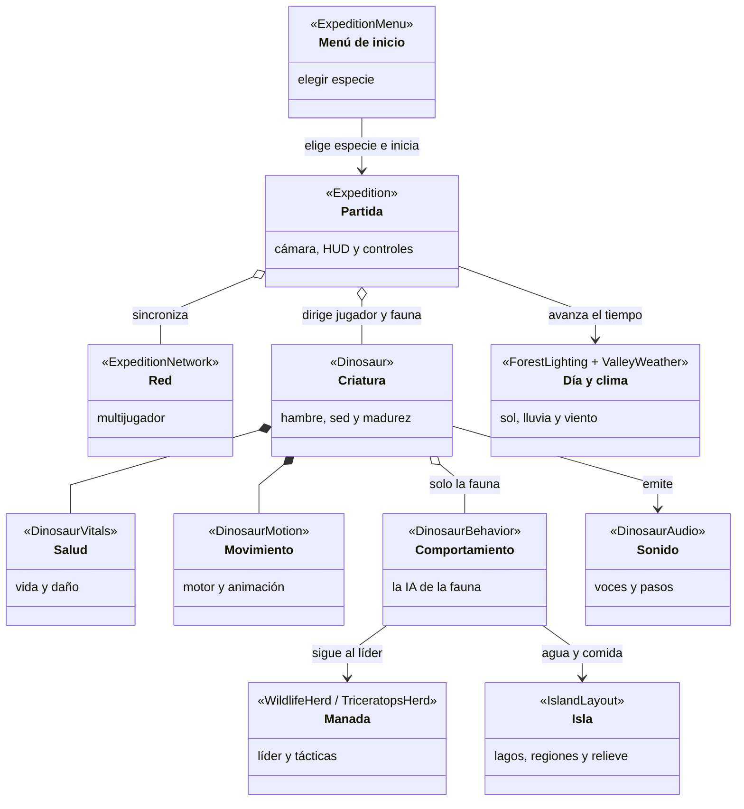

*Imagen exportada: [PNG](uml/A0_vista_rapida.png) · [SVG](uml/A0_vista_rapida.svg)*

Cómo leerlo: la **Partida** es el director de orquesta — maneja la cámara, la interfaz y qué criatura controla el jugador. Cada **Criatura** es un dinosaurio con tres piezas internas: su **Salud**, su **Movimiento** y, si es fauna, un **Comportamiento** que decide qué hace consultando a la **Isla** (dónde hay agua y comida) y a su **Manada** (a quién seguir o de quién huir). El **Clima** pone el día, la noche y las tormentas; el **Sonido**, las voces de cada animal. La **Red** copia la partida a otra computadora cuando hay dos jugadores.

### A.1 Paquetes y dependencias

Las flechas sólidas muestran dependencias de código. El ensamblado `JurassicPix.Core` contiene las reglas de salud, los datos de control y pose y los contratos. `JurassicPix.Runtime` lo referencia y contiene las capas lógicas de presentación, simulación y servicios técnicos. El código de Editor arma los componentes de la escena y las pruebas usan un ensamblado propio.

<!-- diagrama: A1_paquetes -->
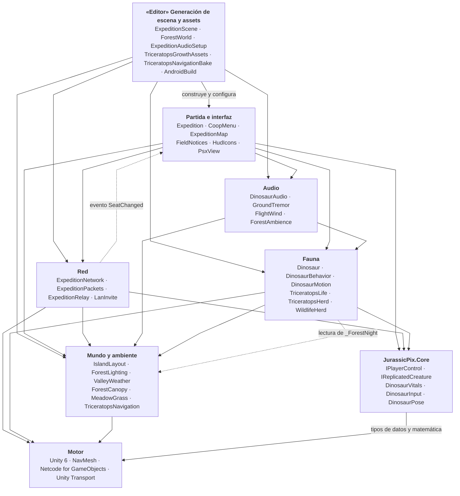

*Imagen exportada: [PNG](uml/A1_paquetes.png) · [SVG](uml/A1_paquetes.svg)*

Lectura del diagrama:

- El código de juego nunca depende del paquete **Editor**: la escena `Expedicion.unity` es un artefacto que `ExpeditionScene.Rebuild` genera por código.
- Presentación y red comparten contratos del núcleo. `ExpeditionNetwork` recibe `IReplicatedCreature` para enviar comandos y guardar poses. `MeadowGrass` consulta la capa física en `IslandLayout`.
- Las líneas punteadas marcan flujos indirectos. `SeatChanged` lleva a la interfaz los cambios de asignación. La fauna consulta el valor global `_ForestNight` que publica `ForestLighting`.
- **Dentro** del paquete Fauna las dependencias son circulares (`Dinosaur` ↔ `DinosaurBehavior` ↔ `TriceratopsLife` ↔ `TriceratopsHerd`, y `IslandSites` conoce a las manadas que a su vez lo consultan). Según la clasificación de Rabin, el conjunto es **modular por capas**, con un núcleo de fauna de acoplamiento **ad-hoc**.

### A.2 Herencia: un solo nivel

<!-- diagrama: A2_herencia -->
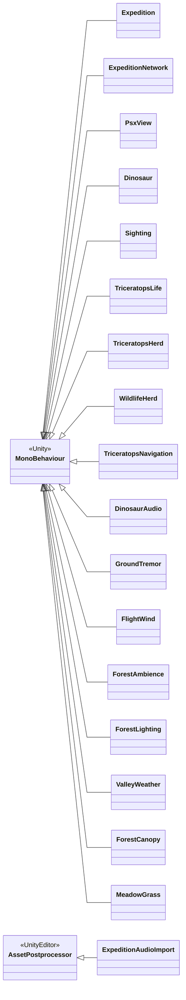

*Imagen exportada: [PNG](uml/A2_herencia.png) · [SVG](uml/A2_herencia.svg)*

Las 17 clases de juego que heredan lo hacen directamente de `MonoBehaviour` y todas son `sealed`: la jerarquía propia tiene **profundidad 1**. No hay clases abstractas ni interfaces propias. Las cinco especies **no** son subclases (`Triceratops : Dinosaur`): son la misma clase `Dinosaur` configurada con datos (`Dinosaur.Profile`) y, en el caso del Triceratops, con un componente más (`TriceratopsLife`). Es composición por componentes, la opción que la bibliografía recomienda frente a jerarquías profundas.

### A.3 Núcleo de fauna

<!-- diagrama: A3_fauna -->
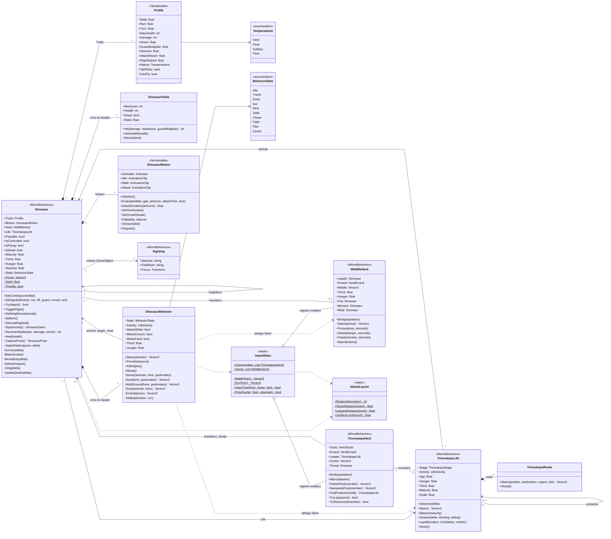

*Imagen exportada: [PNG](uml/A3_fauna.png) · [SVG](uml/A3_fauna.svg)*

Puntos a notar:

- `Dinosaur` **compone** cuatro partes: los datos de la especie (`Profile`), la animación (`DinosaurMotion`), la vida (`DinosaurVitals`) y la decisión (`DinosaurBehavior`). Las dos últimas las crea en `Awake` y nadie más las ve.
- Hay **dos clases de grupo sin relación entre sí**: `TriceratopsHerd` (manada con ciclo de vida, nidos y tácticas) y `WildlifeHerd` (el resto). Como no comparten un tipo, quien necesita "una manada cualquiera" guarda un `object` y pregunta de qué clase es (`quarry is TriceratopsHerd community ? community.Center : ((WildlifeHerd)quarry).Middle`, en `WildlifeHerd` y en `DinosaurBehavior`).
- El Triceratops es el caso especial: `Dinosaur` pregunta `Life != null` para decidir de dónde saca la sed, el hambre, la madurez, la velocidad y la actividad.

### A.4 Partida, interfaz y red

<!-- diagrama: A4_partida_red -->
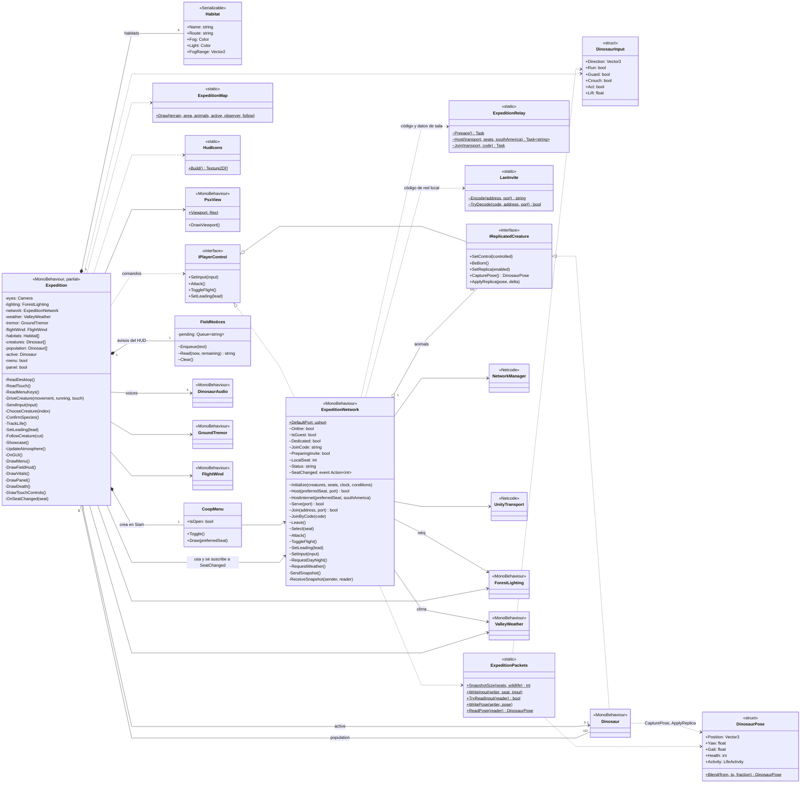

*Imagen exportada: [PNG](uml/A4_partida_red.png) · [SVG](uml/A4_partida_red.svg)*

`Expedition` lee los controles, coordina la cámara y el ciclo de vida, y dibuja los menús y el HUD. El control local y el control de red se usan a través de `IPlayerControl`. La cola de avisos del HUD vive en `FieldNotices`.

### A.5 Mundo, ambiente y audio

<!-- diagrama: A5_mundo_audio -->
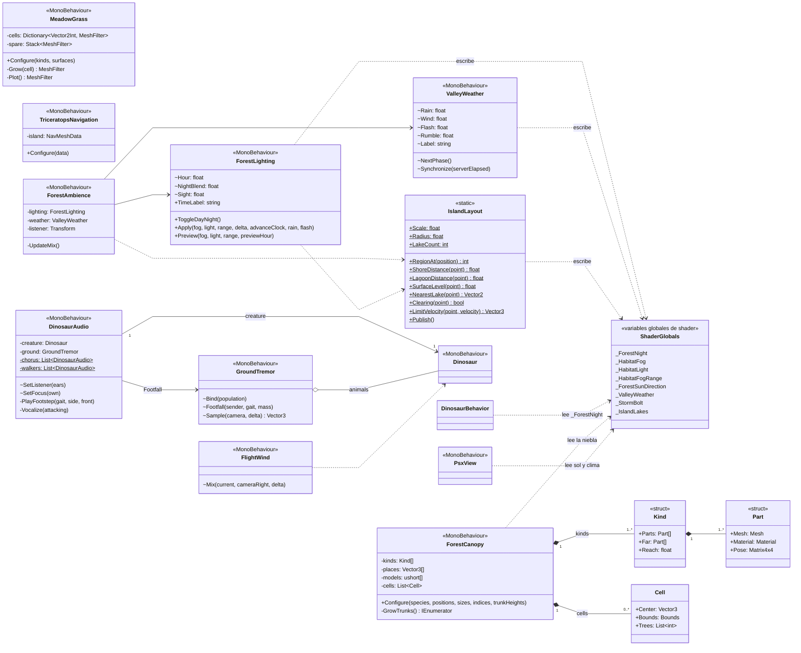

*Imagen exportada: [PNG](uml/A5_mundo_audio.png) · [SVG](uml/A5_mundo_audio.svg)*

`ShaderGlobals` no es una clase del proyecto: representa las variables globales de shader, que funcionan como una pizarra compartida. Se dibuja para dejar a la vista ese acoplamiento. `ForestCanopy` aplica el patrón **Flyweight**: guarda una vez cada especie de árbol (`Kind`, con sus mallas y materiales) y, por cada uno de los más de 50.000 árboles, solo la posición, la forma y el índice de su especie. `MeadowGrass` recicla las mallas de pasto con una pila (`spare`), un **Object Pool**.

### A.6 Generación de la escena (editor)

<!-- diagrama: A6_editor -->
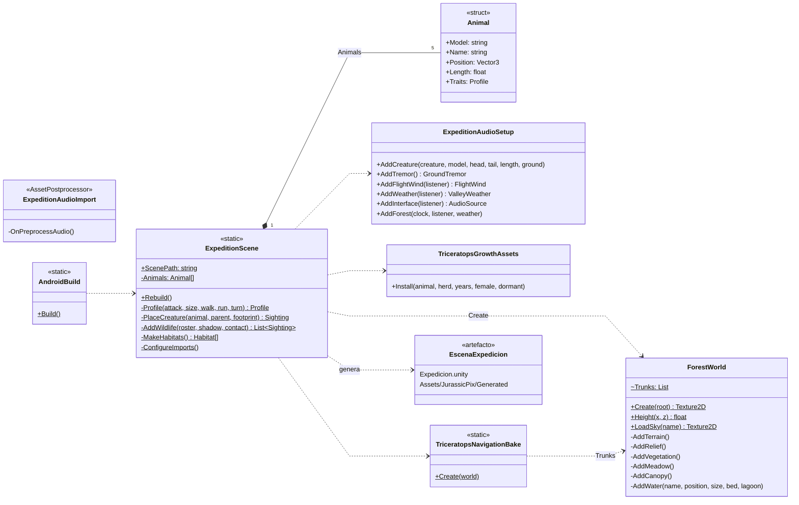

*Imagen exportada: [PNG](uml/A6_editor.png) · [SVG](uml/A6_editor.svg)*

`ExpeditionScene` cumple el rol de **fábrica** de todo el juego: arma la isla, instancia las 112 criaturas (104 vivas al empezar y 8 lugares reservados para nacimientos) y conecta cada componente con sus dependencias a través de campos `[SerializeField]` y métodos `Configure`. Es **inyección de dependencias** hecha por el generador de la escena en lugar de por el Inspector.

### A.7 Estados

Etapas de vida del jugador (`Dinosaur.Maturity`, `BeBorn`, `Survive`, y `Expedition.TrackLife`):

<!-- diagrama: A7_ciclo_de_vida -->
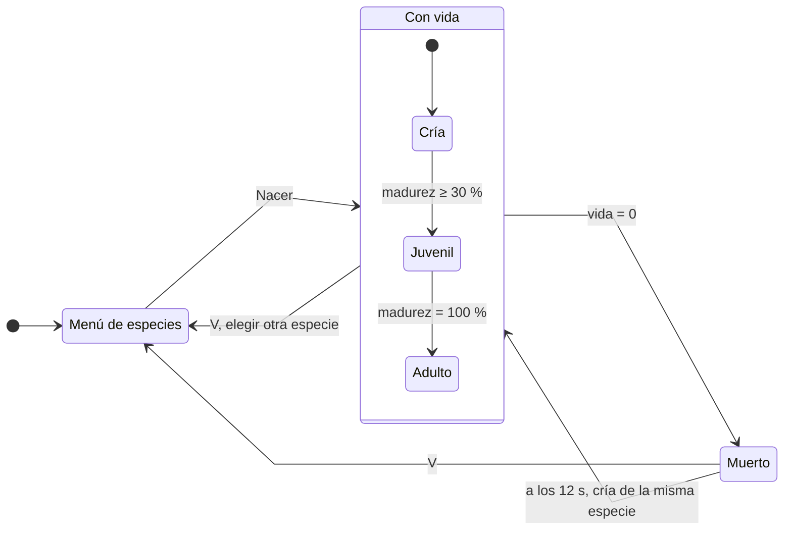

*Imagen exportada: [PNG](uml/A7_ciclo_de_vida.png) · [SVG](uml/A7_ciclo_de_vida.svg)*

La madurez solo avanza mientras la sed y el hambre estén por debajo del 80 %; de cero a adulto lleva unos 8 minutos (480 s). El Quetzalcoatlus puede volar desde juvenil y solo un adulto puede liderar a su grupo (**L**).

Máquina de estados de la fauna silvestre que no es Triceratops (`DinosaurBehavior.Settle`). Cada cuadro, la conducta propone un estado y `Settle` decide si se cambia. El diagrama agrupa los diez estados y muestra las transiciones típicas:

<!-- diagrama: A7_conducta -->
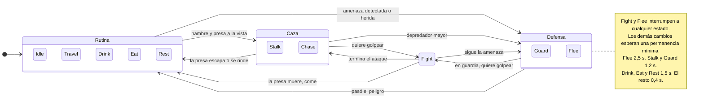

*Imagen exportada: [PNG](uml/A7_conducta.png) · [SVG](uml/A7_conducta.svg)*

Táctica de una manada de Triceratops (`TriceratopsHerd.UpdateTactic`):

<!-- diagrama: A7_tactica_manada -->
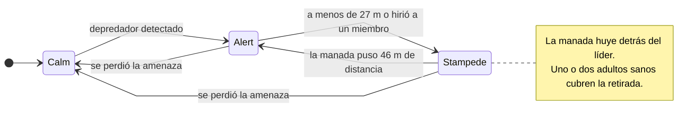

*Imagen exportada: [PNG](uml/A7_tactica_manada.png) · [SVG](uml/A7_tactica_manada.svg)*

### A.8 Secuencia: un ataque del jugador en modo individual

<!-- diagrama: A8_secuencia_ataque -->
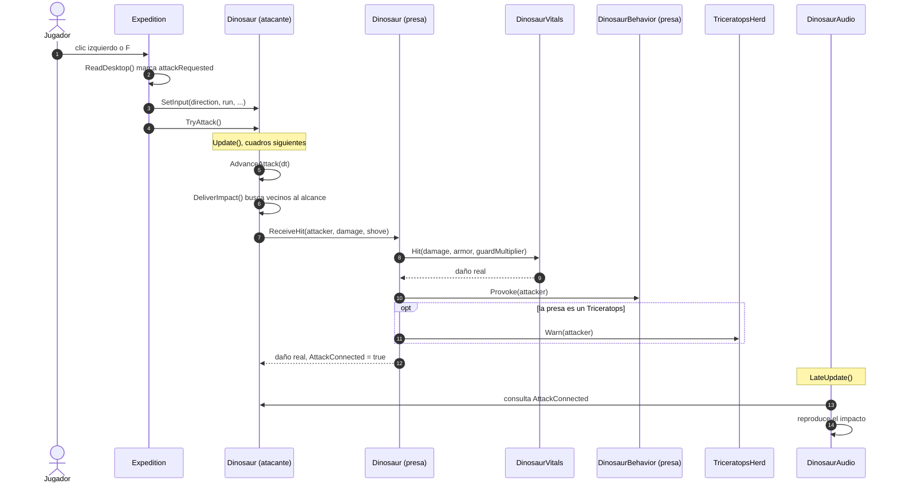

*Imagen exportada: [PNG](uml/A8_secuencia_ataque.png) · [SVG](uml/A8_secuencia_ataque.svg)*

En red, los pasos 3 y 4 cambian: `Expedition` llama a `ExpeditionNetwork.SetInput` y `Attack`, el anfitrión ejecuta el golpe y los invitados lo ven en la instantánea siguiente. Los últimos dos pasos muestran que el audio **consulta** el estado cada cuadro en lugar de recibir un aviso.

## 3. Evaluación SOLID del código actual

La evaluación combina el relevamiento del 22/11 con los contratos y la cola incorporados en la entrega del 23/11.

### S — Responsabilidad única

| | Clase | Observación |
| --- | --- | --- |
| Cumple | `DinosaurVitals` (37 líneas) | Solo vida: daño con armadura y guardia, límites, redimensionado. De Unity solo usa `Mathf`. |
| Cumple | `DinosaurMotion` | Solo animación y pose del esqueleto. |
| Cumple | `ExpeditionPackets` | Solo serializa entradas y poses. |
| Cumple | `FieldNotices` | Ordena los mensajes y controla su tiempo de exposición en el HUD. |
| Cumple | `IslandLayout`, `ForestLighting`, `ValleyWeather`, `ForestCanopy`, `MeadowGrass`, `GroundTremor`, `FlightWind` | Cada una resuelve un tema. |
| No cumple | `Expedition` (1.384 líneas en dos archivos, unos 65 métodos) | Entrada de escritorio y táctil, cámara, menú, HUD, panel, pantalla de muerte, flujo de la partida, atmósfera por región y enrutamiento a la red. Tiene por lo menos siete motivos distintos para cambiar. |
| No cumple | `Dinosaur` (860 líneas) | Movimiento, vuelo, aguante, sed y hambre, crecimiento, combate, agarre del Velociraptor, muerte y reaparición, y réplica de red. |
| No cumple | `DinosaurBehavior` (773 líneas) | Percepción, caza, defensa, vuelo, recados y evasión de obstáculos para los cuatro temperamentos en una sola clase. |
| Parcial | `TriceratopsHerd` (828 líneas) | Táctica, liderazgo, recados y reproducción. Es cohesiva (todo es "la manada"), pero la reproducción podría separarse. |

### O — Abierto/cerrado

| | Dónde | Observación |
| --- | --- | --- |
| Cumple | `Dinosaur.Profile` y `ExpeditionScene.Animals` | Los valores de cada especie son datos. Ajustar una especie, o agregar otra con un temperamento que ya existe, no toca la lógica. |
| Cumple | `ForestCanopy.Kind`, `MeadowGrass.Tuft` | Agregar un árbol o una mata es agregar datos. |
| Cumple | `IPlayerControl` | El código que emite los comandos funciona con cualquier implementación compatible. |
| No cumple | `switch (animal.Traits.Nature)` en `DinosaurBehavior.Steer` | Un temperamento nuevo obliga a modificar la clase. |
| No cumple | 54 líneas en 8 archivos que preguntan `Temperament`, `CanFly` o `TailStrike` | La lógica de "qué clase de animal es" está repartida entre `Dinosaur`, `DinosaurBehavior`, `Expedition`, `ExpeditionMap`, `ExpeditionMenu`, `IslandSites`, `TriceratopsHerd` y `WildlifeHerd`. |
| No cumple | 38 líneas en 8 archivos con `Life != null` | El Triceratops se trata como excepción en cada lugar donde importa. |
| No cumple | `ExpeditionMenu`: arreglos paralelos `Diets`, `Kinds`, `Blurbs`, `BirthTips`, `Difficulty` | Los textos de cada especie se emparejan por posición. Una sexta especie exige editar cinco arreglos en el orden exacto. |
| No cumple | `IslandSites.Prey`: `name == "Triceratops"` | Regla escrita contra el nombre de una especie. |

### L — Sustitución de Liskov

`Expedition` emite el mismo conjunto de comandos haya control local con `Dinosaur` o control en red con `ExpeditionNetwork`. Ambos aceptan `DinosaurInput` y ofrecen ataque, vuelo y liderazgo según las reglas del juego. Las dos clases de manada siguen usando referencias y reglas propias.

### I — Segregación de interfaces

El emisor de comandos depende de `IPlayerControl`, que ofrece cuatro operaciones. La red usa `IReplicatedCreature` para agregar asignación y poses. Otros consumidores todavía reciben el `Dinosaur` completo:

| Consumidor | Qué necesita en realidad |
| --- | --- |
| `ExpeditionMap` | Posición, rumbo, especie, grupo, si está muerto |
| `GroundTremor` | Posición y largo |
| `FlightWind` | Posición y si vuela |
| `DinosaurAudio` | Fases de paso, ataque, actividad y tamaño |

### D — Inversión de dependencias

| | Dónde | Observación |
| --- | --- | --- |
| Cumple | Campos `[SerializeField]` y métodos `Configure` | Las referencias entre componentes las inyecta `ExpeditionScene`; las clases no se buscan entre sí con `FindObjectOfType`. |
| Cumple | `ExpeditionNetwork.SeatChanged` | La red avisa por evento y no conoce a `Expedition`. |
| Cumple | `DinosaurBehavior(Dinosaur animal)`, `CoopMenu(ExpeditionNetwork network)` | Dependencias recibidas por constructor. |
| No cumple | `Dinosaur.Focus`, `Sight`, `Throttle` (estáticos) | `Expedition` los escribe cada cuadro y todas las criaturas los leen. Es estado global. |
| No cumple | `IslandSites.Communities` y `Herds` (listas estáticas) | Registro global que `Expedition.Start` limpia y las manadas llenan. |
| No cumple | `Shader.GetGlobalFloat("_ForestNight")` en `DinosaurBehavior`, `TriceratopsHerd` y `WildlifeHerd` | La IA averigua si es de noche leyendo una variable de shader que escribe `ForestLighting`. La dependencia real (IA → reloj) no figura en ninguna firma. |
| No cumple | `Camera.main` en `ForestCanopy` y `MeadowGrass` | Dependencia global del motor. |
| Cumple en control y réplica | `IPlayerControl` e `IReplicatedCreature` | Los contratos son del núcleo. Presentación y red dependen de ellos. La sesión se configura con el componente de red en la escena. |
| No cumple | `IslandLayout` estático | Las reglas de la isla no se pueden reemplazar por otras en una prueba. |

### Resumen

| Principio | Estado actual | Prioridad de mejora |
| --- | --- | --- |
| S | Bien en las clases chicas; mal en `Expedition`, `Dinosaur` y `DinosaurBehavior` | Alta |
| O | Bien en los datos; mal en la lógica por especie | Alta |
| L | El mismo consumidor usa control local y de red | Media |
| I | Contratos acotados para comandos y réplica | Media |
| D | Contratos del núcleo e inyección por escena en control y red. Queda estado global del mundo | Media |

## 4. Parte B — Diseño propuesto aplicando SOLID

Criterios del rediseño:

- **Componer, no heredar.** Se mantiene una sola clase `Dinosaur` y las diferencias entre especies pasan a ser piezas intercambiables detrás de interfaces. No se crea una jerarquía `Dinosaur → Herbívoro → Triceratops`: un pterosaurio cazador o un saurópodo que barre con la cola no entran limpios en un árbol de herencia.
- **Herencia solo de un nivel y solo para contratos** (interfaces y fábricas abstractas).
- **Respetar las restricciones del proyecto:** la escena se sigue generando por código, el anfitrión sigue simulando la fauna y se conserva la simulación a ritmo reducido de lo que no se ve.
- **No reintroducir** el modo explorador ni el cambio libre de criatura.

### B.1 La criatura por composición

<!-- diagrama: B1_criatura -->
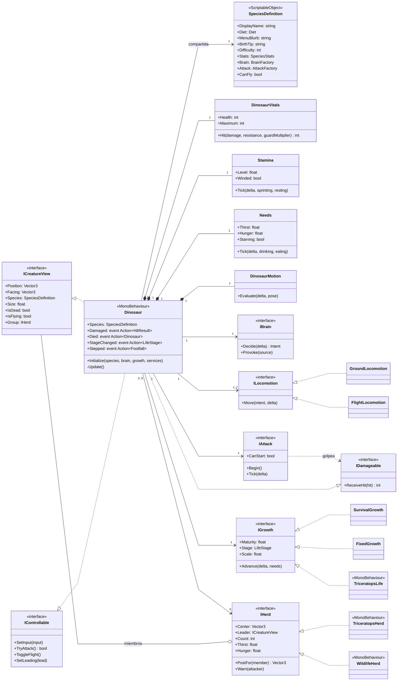

*Imagen exportada: [PNG](uml/B1_criatura.png) · [SVG](uml/B1_criatura.svg)*

Qué cambia respecto de A.3:

- `Dinosaur` deja de calcular todo y pasa a **coordinar** piezas. `Stamina` y `Needs` salen de sus campos privados y quedan como clases chicas que se pueden probar sin escena, igual que hoy `DinosaurVitals`.
- `SpeciesDefinition` es un `ScriptableObject` **compartido** por todos los individuos de la especie (Flyweight). Reemplaza a `Dinosaur.Profile`, que hoy se serializa una vez por criatura, y a los cinco arreglos paralelos del menú.
- `IGrowth` reemplaza a los `Life != null ? ... : ...`: el jugador usa `SurvivalGrowth` (crece si come y bebe), la fauna silvestre `FixedGrowth` y el Triceratops su `TriceratopsLife`.
- `IHerd` da un tipo común a las dos manadas: desaparecen los `object` y los `is TriceratopsHerd`.
- Los consumidores piden la interfaz mínima: el minimapa, el temblor y el viento reciben `ICreatureView`; los ataques, `IDamageable`; la entrada y la red, `IControllable`.
- Los **eventos** (`Damaged`, `Died`, `StageChanged`, `Stepped`) reemplazan la consulta por cuadro de `DinosaurAudio`, `GroundTremor` y el HUD (patrón Observer con delegados de C#).

### B.2 Conducta y ataque: estrategias y fábricas

<!-- diagrama: B2_estrategias -->
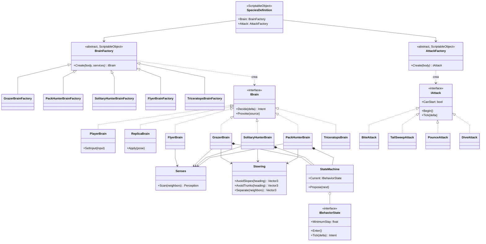

*Imagen exportada: [PNG](uml/B2_estrategias.png) · [SVG](uml/B2_estrategias.svg)*

- **Strategy:** cada temperamento es una clase que implementa `IBrain`. El `switch (Traits.Nature)` desaparece. `PlayerBrain` y `ReplicaBrain` cubren los casos que hoy se resuelven consultando `IsControlled` (26 líneas de `Dinosaur`) y `replica` (14 líneas).
- **Factory Method:** `BrainFactory.Create` y `AttackFactory.Create` son los métodos fábrica; cada subclase concreta decide qué estrategia instanciar. La especie elige su fábrica desde el asset, así que una especie nueva con conducta nueva se agrega **sin modificar** `Dinosaur` (principio abierto/cerrado).
- **State:** los diez valores de `BehaviorState` pasan a ser objetos con su permanencia mínima, y `StateMachine` conserva la regla que hoy vive en `Settle`.
- `Senses` y `Steering` agrupan lo que los cerebros comparten (percepción y evasión de pendientes, troncos y vecinos) para no duplicarlo.
- `PounceAttack` cubre el salto con agarre del Velociraptor, `TailSweepAttack` el barrido del Argentinosaurus (golpea a todos los que alcanza) y `DiveAttack` el picado del Quetzalcoatlus.

### B.3 Partida, entrada, interfaz y servicios

<!-- diagrama: B3_partida -->
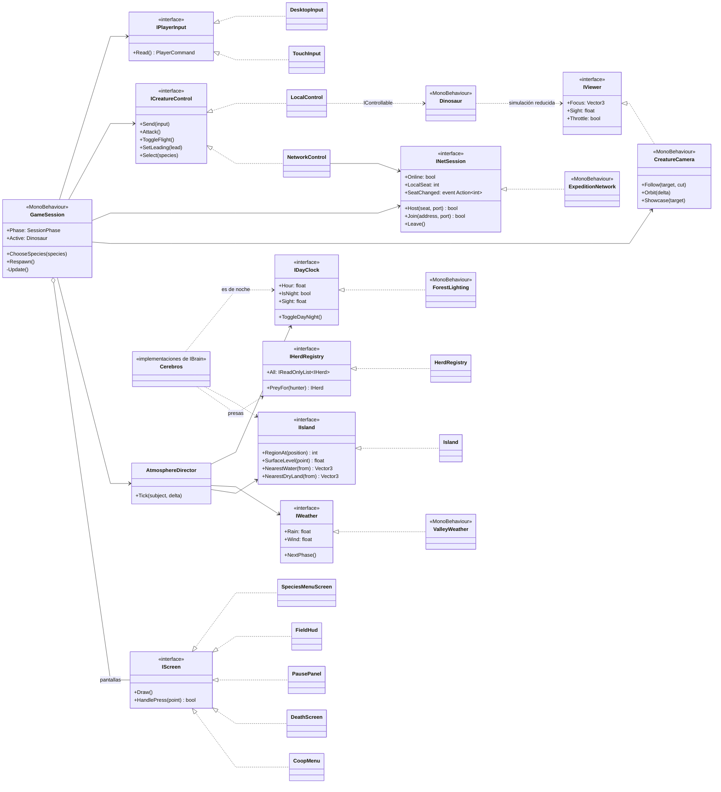

*Imagen exportada: [PNG](uml/B3_partida.png) · [SVG](uml/B3_partida.svg)*

- `Expedition` se divide en `GameSession` (el flujo menú → vida → muerte → renacer), una fuente de entrada (`IPlayerInput`), la cámara, la atmósfera y una pantalla por cada cosa que hoy dibuja `OnGUI`. Cada pieza tiene un solo motivo de cambio.
- `ICreatureControl` reemplaza las 16 preguntas a `network.Online`, `IsGuest` y `Dedicated`: en modo individual se instala `LocalControl` y en red `NetworkControl`, y el resto del código no se entera.
- Los **servicios** (`IDayClock`, `IWeather`, `IIsland`, `IViewer`, `IHerdRegistry`) son las abstracciones de las que pasa a depender la fauna. Reemplazan a `Shader.GetGlobalFloat("_ForestNight")`, a los estáticos `Dinosaur.Focus`, `Sight` y `Throttle`, a `IslandSites` y a las llamadas directas a `IslandLayout`. Las variables globales de shader siguen existiendo, pero solo para los shaders.
- La inyección la sigue haciendo `ExpeditionScene` al generar la escena, que es quien ya conoce todas las piezas.

### B.4 Qué principio resuelve cada decisión

| Principio | Problema actual (parte A) | Decisión de diseño (parte B) | Patrón |
| --- | --- | --- | --- |
| **S** | `Expedition` con siete responsabilidades | `GameSession`, `IPlayerInput`, `CreatureCamera`, `AtmosphereDirector`, una clase por pantalla | — |
| **S** | `Dinosaur` calcula aguante, sed, hambre y crecimiento | `Stamina`, `Needs`, `IGrowth`, `ILocomotion`, `IAttack` | Componentes |
| **S** | `DinosaurBehavior` con cuatro temperamentos | Un `IBrain` por temperamento, más `Senses` y `Steering` | Strategy |
| **O** | `switch` de temperamento y 54 consultas de tipo | `BrainFactory` y `AttackFactory` elegidas por la especie | Factory Method, Strategy |
| **O** | Arreglos paralelos del menú | `SpeciesDefinition` (`ScriptableObject`) | Flyweight, composición basada en datos |
| **O** | Diez estados en un `enum` con reglas en `Settle` | `IBehaviorState` y `StateMachine` | State |
| **L** | Manadas guardadas como `object` | `IHerd`, implementada por ambas manadas | — |
| **L** | Tres fuentes de crecimiento con ternarios | `IGrowth` con tres implementaciones intercambiables | — |
| **I** | Todos reciben el `Dinosaur` completo | `ICreatureView`, `IDamageable`, `IControllable` | — |
| **I** | El audio y el HUD consultan cada cuadro | Eventos `Damaged`, `Died`, `StageChanged`, `Stepped` | Observer |
| **D** | Estáticos `Focus`, `Sight`, `Throttle` | `IViewer` inyectado | Inyección de dependencias |
| **D** | La IA lee `_ForestNight` del shader | `IDayClock` inyectado | Inyección de dependencias |
| **D** | `Expedition` atado a `ExpeditionNetwork` | `ICreatureControl` e `INetSession` | Strategy |
| **D** | `IslandSites` e `IslandLayout` estáticos | `IHerdRegistry` e `IIsland` | — |

### B.5 Cuidados al implementarlo en Unity

- Unity no serializa campos de tipo interfaz. Las estrategias se eligen con fábricas `ScriptableObject` (como en B.2) o con `[SerializeReference]`; las dependencias entre componentes se siguen pasando con métodos `Configure` desde `ExpeditionScene`.
- Disparar un evento de C# no genera basura, pero suscribirse con una lambda que captura variables sí: conviene suscribir métodos con nombre en `OnEnable` y desuscribir en `OnDisable`.
- Con 112 criaturas, una llamada por interfaz por cuadro no es un costo medible. Lo que sí hay que conservar es la simulación reducida de lo que no se ve (`Throttle`), que en el diseño nuevo consulta a `IViewer`.
- Cambiar `Dinosaur.Profile` por `SpeciesDefinition` cambia datos serializados: hay que regenerar la escena.

## 5. Plan de migración

Pasos chicos; cada uno deja el juego funcionando. Están ordenados de menor a mayor riesgo.

| # | Paso | Principio | Riesgo | Cómo verificar |
| --- | --- | --- | --- | --- |
| 1 | Crear `IHerd` y hacer que `TriceratopsHerd` y `WildlifeHerd` la implementen. Reemplazar los `object quarry` | L, I | Bajo | Los depredadores siguen eligiendo manadas en el minimapa |
| 2 | Extraer `Stamina` y `Needs` de `Dinosaur`, con pruebas de edición (Unity Test Framework) junto a `DinosaurVitals` y `ExpeditionPackets` | S | Bajo | Pruebas unitarias |
| 3 | Agregar los eventos `Damaged`, `Died`, `StageChanged` y suscribir el HUD y el audio | I, D | Bajo | Los sonidos de impacto y los avisos de etapa siguen apareciendo |
| 4 | Separar `Expedition`: `IPlayerInput` (escritorio y táctil), `CreatureCamera`, pantallas `IScreen` | S | Medio | Recorrer todos los controles del README en PC |
| 5 | `ICreatureControl` con `LocalControl` y `NetworkControl` | D | Medio | Prueba con dos instancias en `127.0.0.1` |
| 6 | `SpeciesDefinition` como `ScriptableObject`, generado por `ExpeditionScene` | O | Medio | Regenerar la escena y comparar las barras del menú |
| 7 | `IDayClock`, `IWeather`, `IViewer`, `IIsland` inyectados; quitar estáticos | D | Medio | Medir con el Profiler que el cuadro siga en unos 21 ms |
| 8 | `IBrain` por temperamento y `StateMachine` | S, O | Alto | Comparar conductas con las descriptas en el README |
| 9 | `IAttack`, `ILocomotion`, `IGrowth` | S, O, L | Alto | Combate, vuelo y crecimiento de las cinco especies |

## 6. Vínculo con los ejes de la cátedra

| Eje de la Actividad N.º 1 | Dónde se ve en este documento |
| --- | --- |
| UML: los 6 tipos de relaciones | Sección 1 y todos los diagramas de clases |
| Herencia: peligro de las jerarquías profundas | A.2: profundidad 1; parte B: se decide no crear una jerarquía de especies |
| Polimorfismo e interfaces | `IPlayerControl` e `IReplicatedCreature` en A.4. `IBrain` e `IHerd` en el diseño propuesto |
| Composición sobre herencia, arquitectura por componentes | `Dinosaur` + `TriceratopsLife` + `DinosaurAudio` + `Sighting` en un mismo GameObject |
| Herencia versus componentes: criterio | Sección 4, criterios del rediseño |
| Patrón Observer y delegados de C# | `ExpeditionNetwork.SeatChanged` (actual); eventos de `Dinosaur` (propuesto) |
| Patrón Object Factory | `ExpeditionScene.PlaceCreature` (actual); `BrainFactory` y `AttackFactory` (propuesto) |
| Patrón Flyweight | `ForestCanopy.Kind` (actual); `SpeciesDefinition` (propuesto) |
| Patrón Singleton | No se usa. Su función la cumplen clases estáticas (`IslandLayout`, `IslandSites`), que la parte B reemplaza por servicios inyectados |
| Composición basada en datos, ScriptableObjects, Prefabs | `Dinosaur.Profile` y la escena generada (actual); `SpeciesDefinition` (propuesto) |
| `[SerializeField]` y flujo de trabajo de diseño | Los campos ajustables (`TriceratopsHerd.incubation`, `ValleyWeather.rainChance`, los de `PsxView`) |
| Modelos arquitectónicos: ad-hoc, modular, DAG, por capas | A.1 |
| Código de motor versus código de juego | A.1: el bloque "Motor" frente a los seis paquetes propios |
| Máquinas de estados | A.7 |

## 7. Referencias y uso de IA

1. Universidad Nacional de Jujuy, Facultad de Ingeniería (2026). *Actividad N.º 1: Conceptos introductorios y arquitectura de software*. Consigna de Programación de Videojuegos II.
2. Rabin, S. (ed.). *Introduction to Game Development*. Parte III: Game Programming.
3. Vega, A. A. *Principios SOLID: Single Responsibility Principle; Open Closed Principle y Factory Method; Sustitución de Liskov*. Material de cátedra.
4. Unity Technologies. *Level up your code with design patterns and SOLID*. E-book compartido como material de consulta.
5. Material de cátedra. *Introducción a los patrones de diseño*.
6. Código fuente de Jurassic Pix: `Assets/JurassicPix/Scripts` y `Assets/JurassicPix/Editor`.

**Uso de inteligencia artificial generativa.** El relevamiento del código, el armado de los diagramas en Mermaid y la redacción inicial de este documento se hicieron con un asistente de programación basado en IA (Devin), a partir del código del proyecto y de la consigna de la cátedra. Los integrantes deben revisar los diagramas contra el código, contrastar los conceptos con las fuentes citadas y ajustar el texto antes de entregarlo.
